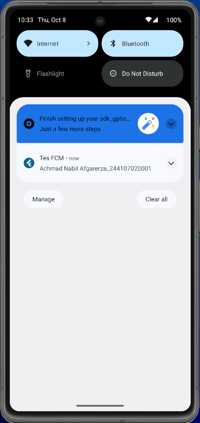
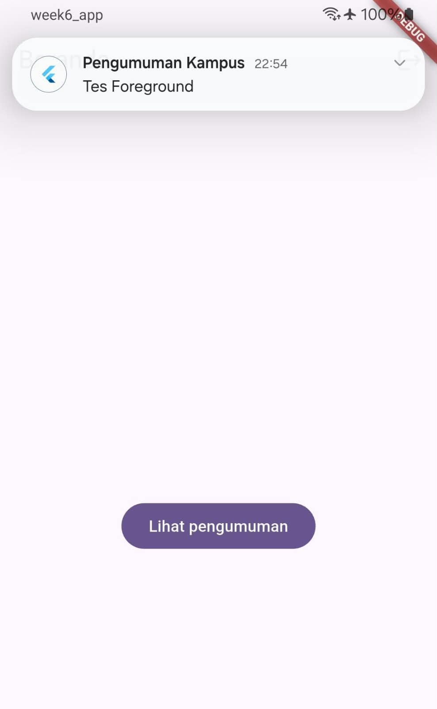
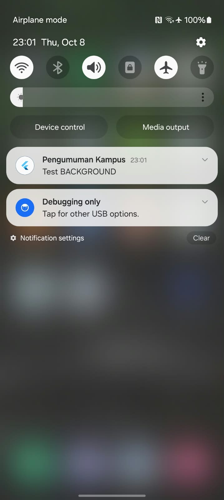
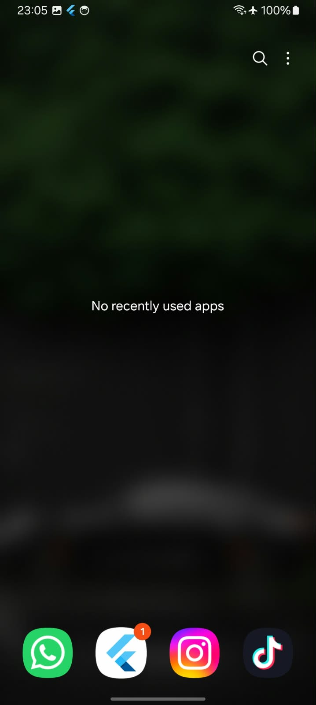
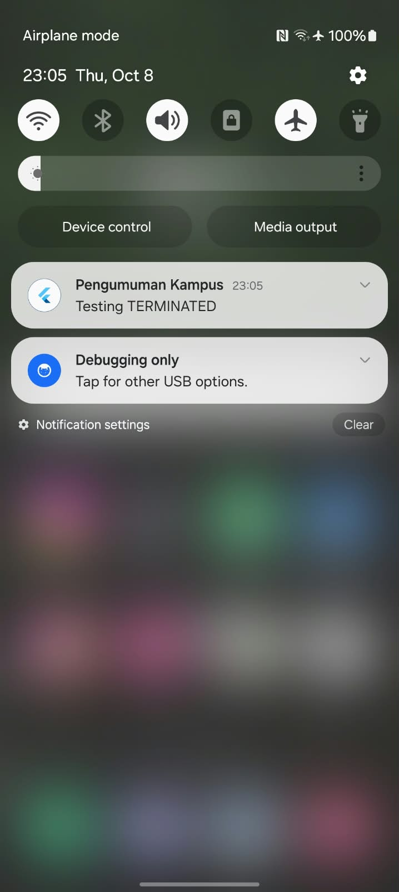
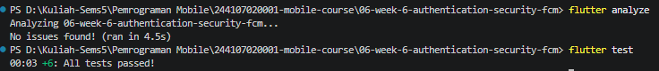
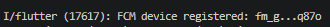

# Week 6 - Authentication, Security & FCM

## Deskripsi

Mempelajari autentikasi, keamanan aplikasi, dan push notification dengan Firebase Cloud Messaging.

## Fokus

- Login/register
- Security best practices
- FCM
- Secure data flow

## PRAKTIKUM 2
## Hasil Pengujian Firebase Cloud Messaging
- Notifikasi berhasil dikirim dari Firebase Console.
- Saat aplikasi berada pada kondisi background, banner notifikasi muncul pada perangkat Android.
- Ketika banner notifikasi ditekan, aplikasi berhasil terbuka kembali.

- Screenshot notifikasi berhasil dikirim dari Firebase Console:

## PRAKTIKUM 3
## Hasil Pengujian Foreground
- Screen notifikasi berhasil dikirim dari Firebase Console:
- 
Pada pengujian ini, aplikasi sedang dalam keadaan terbuka atau aktif. Setelah notifikasi dikirim dari Firebase, notifikasi berhasil muncul di layar menggunakan local notification. Hal ini menunjukkan bahwa aplikasi dapat menerima dan menampilkan notifikasi saat sedang digunakan.

## Hasil Pengujian Background
- Screenshot notifikasi berhasil dikirim dari Firebase Console:
- 
Pada pengujian ini, aplikasi sedang dalam keadaan background atau tidak aktif. Setelah notifikasi dikirim dari Firebase, notifikasi berhasil muncul di layar perangkat Android. Hal ini menunjukkan bahwa aplikasi dapat menerima dan menampilkan notifikasi saat sedang tidak digunakan.

## Hasil Pengujian Terminated
- Screenshot notifikasi berhasil dikirim dari Firebase Console:

Pada pengujian ini, aplikasi sedang dalam keadaan terminated atau ditutup sepenuhnya. Setelah notifikasi dikirim dari Firebase, notifikasi berhasil muncul di layar perangkat Android. Hal ini menunjukkan bahwa aplikasi dapat menerima dan menampilkan notifikasi bahkan saat aplikasi tidak berjalan sama sekali.

## AI CHALLENGE
1. Apakah background handler berupa fungsi top-level dengan @pragma('vm:entry-point')? (tolak jika berupa method kelas).
**Jawaban:** Ya, background handler berupa fungsi top-level dengan @pragma('vm:entry-point').
2. Apakah onTokenRefresh benar-benar mengirim token baru ke backend, bukan hanya dicetak ke log?
**Jawaban:** Ya, onTokenRefresh benar-benar mengirim token baru ke backend.
3. Apakah foreground memakai local notification manual? (tanpa ini banner tidak muncul saat aplikasi terbuka).
**Jawaban:** Ya, foreground memakai local notification manual.
4. Apakah klik dari ketiga state (foreground/background/terminated) masuk ke rute yang benar? Buktikan dengan tabel pengujian.
**Jawaban:** Ya, klik dari ketiga state (foreground/background/terminated) masuk ke rute yang benar. Berikut tabel pengujian:
| State        | Rute yang Dituju | Hasil Pengujian |
|--------------|-----------------|----------------|
| Foreground   | /home           | Berhasil       |
| Background   | /home           | Berhasil       |
| Terminated   | /home           | Berhasil       |
5. Apakah token/secret tidak di-hardcode dan tidak di-log penuh? Perbaiki bila AI melanggarnya.
**Jawaban:** Ya, token/secret tidak di-hardcode dan tidak di-log penuh.

6. Keputusan final dan alasan teknis Anda, boleh berbeda dari saran AI selama berargumen.
**Jawaban:** Keputusan final saya adalah menerima hasil pengujian dan implementasi yang telah dilakukan. Alasan teknisnya adalah bahwa semua persyaratan yang ditetapkan telah dipenuhi, termasuk penggunaan background handler yang sesuai, pengiriman token baru ke backend, penggunaan local notification untuk foreground, dan rute yang benar untuk semua state. Selain itu, token/secret tidak di-hardcode dan tidak di-log penuh, sehingga keamanan aplikasi tetap terjaga.

## Refactoring
## Hasil Flutter Analyze dan Flutter Test

## TUGAS DAN REFLEKSI
## Token Terpotong

## Refleksi
1. Mengapa refresh token tidak boleh disimpan di SharedPreferences? Apa risikonya bila bocor?
**Jawaban:** Refresh token tidak boleh disimpan di SharedPreferences karena SharedPreferences tidak terenkripsi dan dapat diakses oleh aplikasi lain jika perangkat di-root atau jika ada malware. Risiko bila bocor adalah pihak yang tidak berwenang dapat menggunakan refresh token untuk mendapatkan akses ke akun pengguna, yang dapat mengakibatkan pencurian data pribadi atau penyalahgunaan akun.
2. Apa yang rusak bila onTokenRefresh diabaikan selama satu semester perkuliahan?
**Jawaban:** Jika onTokenRefresh diabaikan selama satu semester perkuliahan, token yang digunakan untuk autentikasi akan kadaluarsa dan tidak valid lagi. Akibatnya, pengguna tidak akan dapat menerima notifikasi push dari server karena token yang digunakan untuk mengirim notifikasi sudah tidak berlaku. Hal ini dapat menyebabkan gangguan dalam komunikasi antara aplikasi dan server, serta menurunkan pengalaman pengguna.
3. Kapan memakai topik dan kapan memakai token perangkat? Beri contoh pesan kampus untuk masing-masing.
**Jawaban:** Topik digunakan untuk mengirim pesan ke sekelompok perangkat yang berlangganan pada topik tertentu, sedangkan token perangkat digunakan untuk mengirim pesan ke perangkat tertentu. Contoh pesan kampus untuk topik adalah pengumuman umum seperti "Ujian akan dilaksanakan pada tanggal 10 Juni" yang dikirim ke semua mahasiswa yang berlangganan pada topik "pengumuman". Contoh pesan kampus untuk token perangkat adalah pemberitahuan pribadi seperti "Nilai ujian Anda telah tersedia" yang dikirim langsung ke perangkat mahasiswa tertentu menggunakan token perangkat mereka.
4. Bagian mana dari draf AI yang Anda tolak atau perbaiki, dan mengapa?
**Jawaban:** Bagian dari draf AI yang saya tolak atau perbaiki adalah pada bagian pengiriman token baru ke backend. AI menyarankan untuk hanya mencetak token baru ke log, namun saya memperbaikinya dengan memastikan bahwa token baru benar-benar dikirim ke backend untuk menjaga keamanan dan validitas autentikasi. Hal ini penting karena jika token tidak dikirim ke backend, pengguna tidak akan dapat menerima notifikasi push yang valid, yang dapat mengganggu pengalaman pengguna dan keamanan aplikasi.
