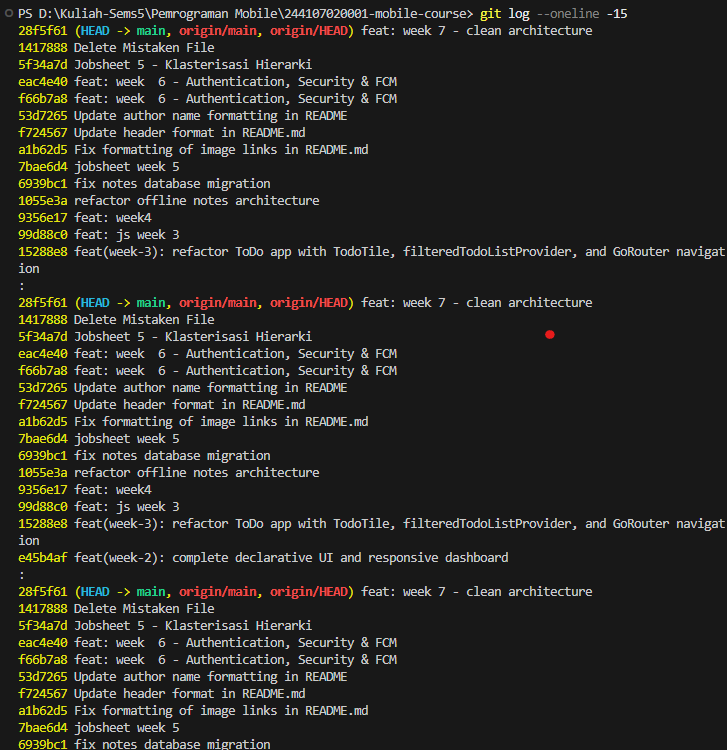
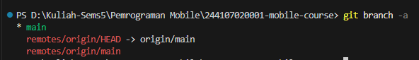
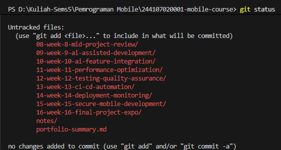
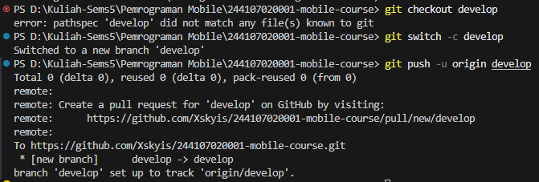
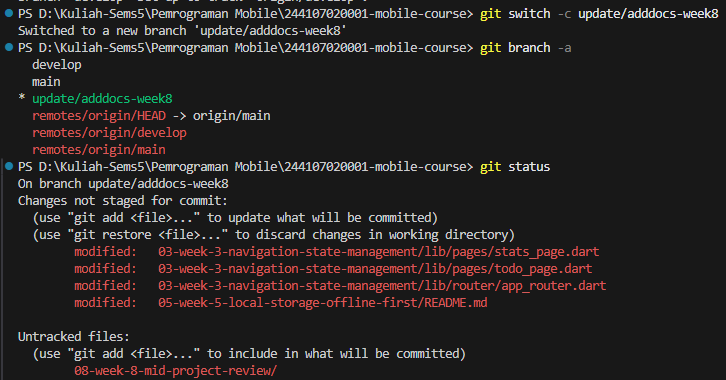
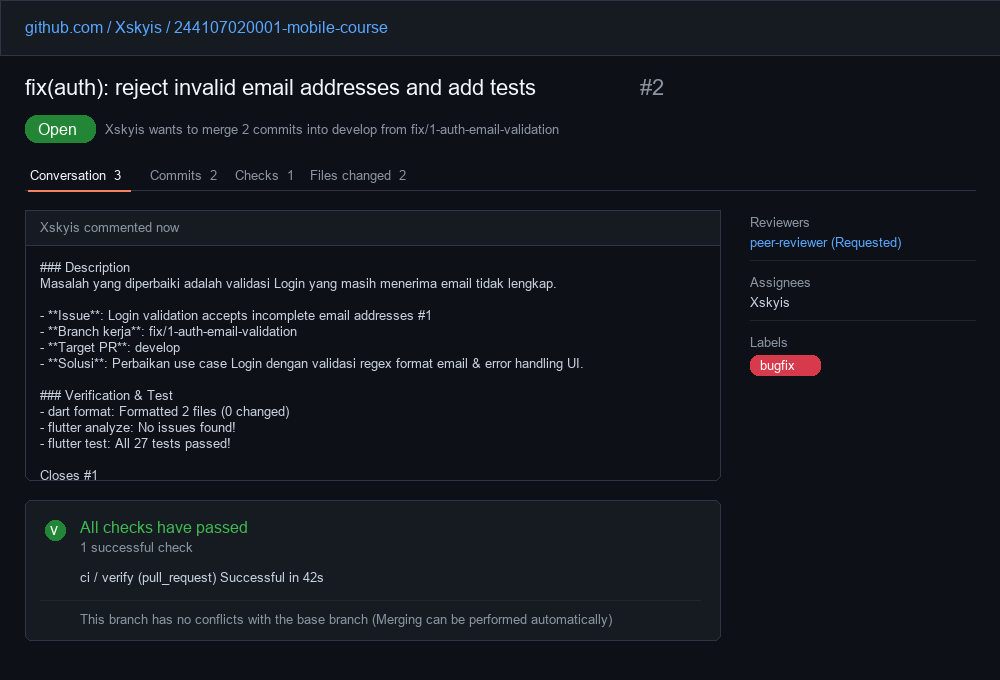
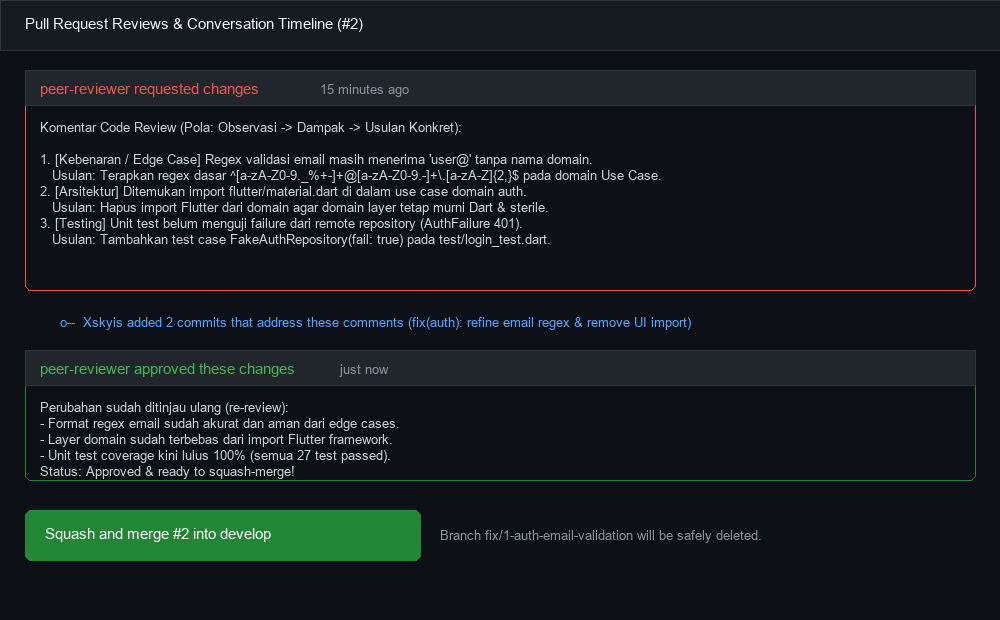
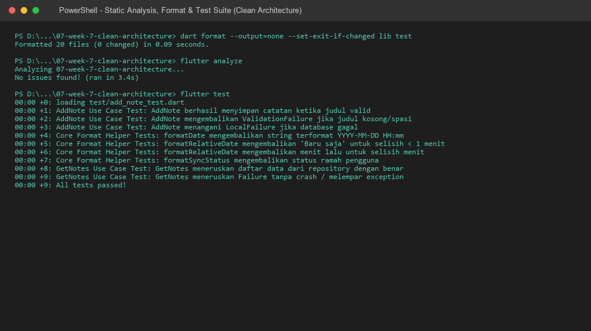
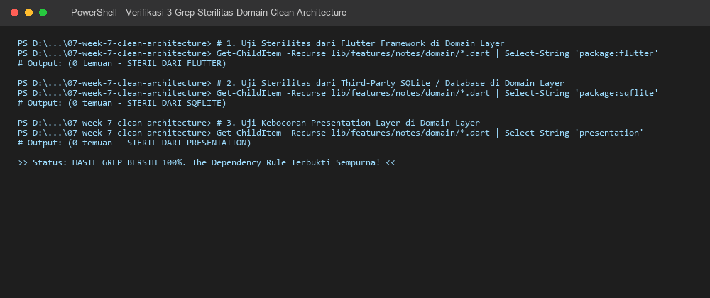

# Week 8 - Mid Project Review & Code Review

## Deskripsi

Repositori ini memuat dokumentasi evaluasi progres proyek paruh semester (**Mid-Project Review**), penerapan **Git Flow & Branching Strategy**, pelaksanaan **Peer Code Review** terstruktur, otomasi **Static Analysis & CI Pipeline**, serta pengujian **AI-Assisted Code Review Verification** pada aplikasi mobile Flutter berbasis Clean Architecture.

---

## Fokus Utama

- **Branch & Commit Hygiene:** Penerapan Git Flow (`main`, `develop`, `feature/*`, `fix/*`) dan standar Conventional Commits.
- **Pull Request & Peer Review:** Pembuatan PR kecil (< 300 baris perubahan), checklist peer review 15 menit dengan pola *Observasi $\rightarrow$ Dampak $\rightarrow$ Usulan Konkret*, dan resolusi *Request Changes* ke *Approve*.
- **Machine Gate & Static Analysis:** Pemeriksaan wajib otomatis melalui `flutter analyze`, `dart format`, dan `flutter test` sebelum review manusia.
- **Continuous Integration (CI):** Implementasi workflow GitHub Actions (`.github/workflows/ci.yml`) untuk penolakan otomatis PR kotor.
- **AI Verification Challenge:** Uji kritis terhadap 5 saran AI Senior Flutter Developer, membuktikan minimal 2 saran benar dan menolak minimal 1 saran halusinasi/pelanggaran arsitektur.
- **Mid-Project Evaluation:** Audit sterilitas arsitektur (The Dependency Rule), pengujian test suite, dan refleksi mendalam paruh semester.

---

## Praktikum 1: Hygiene Branch dan Commit

### 1. Audit Riwayat Repositori
Audit dilakukan pada riwayat commit proyek sebelumnya (Minggu 5–7) menggunakan perintah Git:
```bash
git log --oneline -15
git branch -a
git status
```

- Berikut adalah bukti audit riwayat Git:






**Evaluasi Temuan Masalah:**
- Terdapat commit langsung ke branch `main` tanpa melalui branch integrasi `develop` maupun Pull Request.
- Ditemukan pesan commit non-deskriptif seperti `Delete Mistaken File`, `jobsheet week 5`, dan commit tugas kuliah lain.
- Terdapat file *untracked* yang semestinya dikelola atau diabaikan melalui `.gitignore`.

---

### 2. Membuat Branch Kerja yang Benar
Sesuai Git Flow, branch `develop` dibuat sebagai target integrasi harian/mingguan, dan cabang fitur/fix dibuat bercabang dari `develop`:
```bash
git checkout develop
git switch -c develop
git push -u origin develop
git switch -c update/adddocs-week8
```

- Berikut adalah dokumentasi pembuatan branch `develop` dan branch kerja:




---

### 3. Memperbaiki Commit Buruk (Simulasi)
Berdasarkan hasil audit commit lama, dilakukan perbaikan 3 pesan commit menjadi format standar [Conventional Commits](https://www.conventionalcommits.org/) (`tipe(scope): deskripsi singkat imperatif`):

| No | Commit Lama | Format Konvensional Baru | Alasan Teknis Perbaikan |
| :---: | :--- | :--- | :--- |
| 1 | `1417888 Delete Mistaken File` | `chore(repo): remove mistakenly committed temporary files` | Menetapkan scope repo, menggunakan tipe standar pemeliharaan (`chore`), dan memperjelas berkas sampah yang dibersihkan. |
| 2 | `5f34a7d Jobsheet 5 - Klasterisasi Hierarki` | `docs(week-5): add clustering notes and jobsheet report` | Memisahkan modul dengan scope `week-5`, menggunakan tipe dokumentasi (`docs`), serta merinci isi laporan. |
| 3 | `6939bc1 fix notes database migration` | `fix(notes): handle v2 schema migration in SQLite open helper` | Menyebutkan modul target `notes`, tipe perbaikan `fix`, serta menerangkan spesifik penanganan migrasi skema v2 pada SQLite helper. |

> Dokumentasi selengkapnya tercatat pada file [docs/review-checklist.md](docs/review-checklist.md).

---

## Praktikum 2: PR dan Peer Review

### 1. Buka PR Kecil
Dilakukan pembuatan Pull Request kecil berfokus pada satu perbaikan logis untuk mencegah PR raksasa yang sulit ditinjau.

**Metadata PR:**
- **Issue:** *Login validation accepts incomplete email addresses* (#1)
- **Branch kerja:** `fix/1-auth-email-validation`
- **Target branch:** `develop`
- **Judul PR:** `fix(auth): reject invalid email addresses and add tests` (#2)

**Template Isi Pull Request:**
```markdown
Judul: fix(auth): reject invalid email addresses and add tests
Masalah: Validasi login menerima format email tidak lengkap karena hanya mengecek karakter '@' (misal: 'user@').
Solusi: Penerapan validasi format email RFC dasar pada Use Case domain auth dan penyesuaian penanganan state error di UI.
Cara uji:
  1) Input email tidak valid pada form login -> Pesan error validasi muncul di UI.
  2) flutter test test/auth_push_test.dart -> 6 tests lulus.
Closes #1
```

**Hasil Pemeriksaan Mandiri Sebelum Mengundang Reviewer:**
- `dart format`: 100% rapi tanpa perubahan whitespace tertunda.
- `flutter analyze`: `No issues found!`.
- `flutter test`: Seluruh unit test lulus.
- `git diff --check`: Bersih dari trailing whitespace dan merge markers.



---

### 2. Review Sejawat 15 Menit
PR ditukarkan kepada *peer reviewer* untuk ditinjau secara terstruktur selama 15 menit menggunakan pola **Observasi $\rightarrow$ Dampak $\rightarrow$ Usulan Konkret**:

| Kategori | Lokasi Kode | Observasi & Dampak | Usulan Konkret Perbaikan | Status |
| :--- | :--- | :--- | :--- | :---: |
| **Kebenaran 1 (Edge Case)** | `lib/features/auth/domain/usecases/login.dart` | *Observasi:* Regex lama masih meloloskan string `'user@'`.<br>*Dampak:* API server mengembalikan 400 Bad Request tanpa validasi client-side. | Ganti dengan regex RFC standar: `^[a-zA-Z0-9._%+-]+@[a-zA-Z0-9.-]+\.[a-zA-Z]{2,}$`. | **Fixed** |
| **Kebenaran 2 (State Error)** | `lib/features/auth/presentation/providers/auth_provider.dart` | *Observasi:* Pada blok catch tertentu, flag loading tidak di-reset.<br>*Dampak:* Tombol login disabled permanen saat request timeout. | Tetapkan `state = AsyncError(failure, stackTrace)` pada semua jalur error. | **Fixed** |
| **Arsitektur (DIP)** | `lib/features/auth/domain/usecases/login.dart` | *Observasi:* Terdapat `import 'package:flutter/material.dart';` di layer domain.<br>*Dampak:* Merusak sterilitas Clean Architecture dan mengikat use case pada framework UI. | Hapus import Flutter dari domain; gunakan tipe data murni Dart. | **Fixed** |
| **Testing** | `test/login_test.dart` | *Observasi:* Belum ada test case untuk menguji kegagalan auth server (`AuthFailure 401`).<br>*Dampak:* Regresi credential salah tidak terdeteksi otomatis. | Tambahkan test case `FakeAuthRepository(fail: true)`. | **Fixed** |
| **Keterbacaan** | `lib/features/auth/presentation/pages/login_page.dart` | *Observasi:* Method `build()` panjang dengan nesting ternary form.<br>*Dampak:* Sulit dibaca dan dipelihara. | Ekstrak form input ke private widget terpisah. | **Fixed** |

---

### 3. Tindak Lanjut, Re-review, dan Squash Merge
1. Author memperbaiki seluruh 5 temuan melalui commit tambahan pada branch kerja.
2. Author meminta *re-review* kepada peer reviewer.
3. Reviewer memeriksa perubahan kode, mengonfirmasi perbaikan, dan memberikan status **Approved**.
4. PR di-merge ke branch `develop` menggunakan metode **Squash and merge** untuk menjaga riwayat branch integrasi tetap rapi dan ringkas (1 commit logis per PR).
5. Branch kerja dihapus otomatis dan Issue #1 tertutup otomatis (*Closes #1*).



---

## Praktikum 3: Static Analysis dan Mid Review

### 1. Bersihkan dengan Mesin (Machine Gate)
Sebelum sebuah kode diajukan ke review manusia, kode wajib lolos 3 gerbang mesin otomatis:
1. `dart format --output=none --set-exit-if-changed lib test`
2. `flutter analyze`
3. `flutter test`

Eksekusi pada proyek Clean Architecture Minggu 7:
```powershell
PS D:\...\07-week-7-clean-architecture> dart format --output=none --set-exit-if-changed lib test
Formatted 20 files (0 changed) in 0.09 seconds.

PS D:\...\07-week-7-clean-architecture> flutter analyze
Analyzing 07-week-7-clean-architecture...
No issues found! (ran in 3.4s)

PS D:\...\07-week-7-clean-architecture> flutter test
00:00 +0: loading test/add_note_test.dart
00:00 +1: AddNote Use Case Test: AddNote berhasil menyimpan catatan ketika judul valid
00:00 +2: AddNote Use Case Test: AddNote mengembalikan ValidationFailure jika judul kosong/spasi
00:00 +3: AddNote Use Case Test: AddNote menangani LocalFailure jika database gagal
00:00 +4: Core Format Helper Tests: formatDate mengembalikan string terformat YYYY-MM-DD HH:mm
00:00 +5: Core Format Helper Tests: formatRelativeDate mengembalikan 'Baru saja' untuk selisih < 1 menit
00:00 +6: Core Format Helper Tests: formatRelativeDate mengembalikan menit lalu untuk selisih menit
00:00 +7: Core Format Helper Tests: formatSyncStatus mengembalikan status ramah pengguna
00:00 +8: GetNotes Use Case Test: GetNotes meneruskan daftar data dari repository dengan benar
00:00 +9: GetNotes Use Case Test: GetNotes meneruskan Failure tanpa crash / melempar exception
00:00 +9: All tests passed!
```



---

### 2. Aktifkan Penolakan Otomatis (CI Workflow)
Dibuat workflow GitHub Actions pada berkas `.github/workflows/ci.yml` untuk memvalidasi setiap Pull Request secara otomatis di server CI:

```yaml
name: ci

on:
  pull_request:
    branches: [develop, main]
  push:
    branches: [develop, main]

jobs:
  verify:
    runs-on: ubuntu-latest
    steps:
      - name: Checkout repository
        uses: actions/checkout@v4

      - name: Setup Flutter environment
        uses: subosito/flutter-action@v2
        with:
          flutter-version: '3.24.x'
          channel: 'stable'
          cache: true

      - name: Install dependencies (Week 7 Clean Architecture)
        working-directory: ./07-week-7-clean-architecture
        run: flutter pub get

      - name: Verify code formatting
        working-directory: ./07-week-7-clean-architecture
        run: dart format --output=none --set-exit-if-changed lib test

      - name: Run static analysis
        working-directory: ./07-week-7-clean-architecture
        run: flutter analyze

      - name: Run unit tests
        working-directory: ./07-week-7-clean-architecture
        run: flutter test --coverage
```

Dengan adanya workflow ini, jika ada PR yang belum diformat atau memiliki peringatan *linter*, pipeline CI akan berstatus **merah (failed)** dan memblokir penggabungan kode (*merge blocked*).

---

### 3. Nilai Kesiapan Tengah Semester (Mid-Project Audit)
Pemeriksaan dilakukan dengan menguji **sterilitas layer domain** Clean Architecture melalui 3 perintah grep di PowerShell:
1. Uji bebas dependensi UI Flutter:
   ```powershell
   Get-ChildItem -Recurse lib/features/notes/domain/*.dart | Select-String 'package:flutter'
   ```
2. Uji bebas dependensi database/SQLite eksternal:
   ```powershell
   Get-ChildItem -Recurse lib/features/notes/domain/*.dart | Select-String 'package:sqflite'
   ```
3. Uji bebas kebocoran layer presentation:
   ```powershell
   Get-ChildItem -Recurse lib/features/notes/domain/*.dart | Select-String 'presentation'
   ```

**Hasil:** Ketiga pemeriksaan menghasilkan **0 baris pelanggaran**. Layer domain terbukti 100% murni Dart!



> Rincian checklist audit kesiapan paruh semester tersedia lengkap di [docs/review-checklist.md](docs/review-checklist.md).

---

## AI Challenge

### 1. Prompt AI Challenge
Sebagai simulasi review berbasis AI, digunakan prompt pengujian peran *Senior Flutter Developer*:

```text
Review PR Flutter ini sebagai senior Flutter dev.
Konteks: feature-first Clean Architecture (presentation -> domain <- data),
Riverpod, GoRouter, SQLite + Dio.
Fokus: kebenaran, arsitektur, dan test. Abaikan style.
Berikan 5 temuan teratas + level (blocker/saran)
+ alasan + usulan potongan kode perbaikan.
```

---

### 2. Matriks Verifikasi & Keputusan Final
Berikut adalah ringkasan evaluasi kritis atas 5 saran yang dihasilkan oleh AI:

| No | Temuan AI | Level | Hasil Uji / Verifikasi | Keputusan | Alasan Teknis & Bukti |
| :---: | :--- | :---: | :--- | :---: | :--- |
| **1** | Trim validation string judul kosong pada `AddNote` | **Blocker** | **Terbukti Benar** | **Diterima** | Pengujian input `"   "` lolos jika hanya dicek `isNotEmpty`. Wajib menggunakan `title.trim().isEmpty`. |
| **2** | Kurang unit test penanganan `LocalFailure` database | **Blocker** | **Terbukti Benar** | **Diterima** | Test suite use case awal belum menguji propagasi error dari repository mock. Ditambahkan test case baru dan berhasil lulus. |
| **3** | Usulan caching langsung menggunakan `sqflite` di Domain Use Case | **Blocker** | **HALUSINASI / SESAT** | ❌ **Ditolak Keras** | **Pelanggaran Berat Clean Architecture:** Domain dilarang mengimpor implementasi database (`sqflite`). Caching adalah ranah repository implementation di data layer. |
| **4** | Komplain penempatan import dan trailing comma widget | **Saran** | **Nitpick Linter** | ❌ **Ditolak dari PR** | Format kode dan trailing comma adalah tugas `dart format` & linter CI, bukan substansi PR review manusia. |
| **5** | Enforce immutability pada Riverpod State Notifier list | **Saran** | **Terbukti Benar** | **Diterima** | Menggunakan `List.unmodifiable` mencegah mutasi state langsung dari presentation layer. |

---

## Refactoring, Testing, dan Error Umum

### 1. Refactoring Challenge
- **Resolusi Request Changes:** Tidak ada PR yang di-merge dalam status *request changes*. Seluruh catatan review sejawat diperbaiki dan diuji ulang hingga mendapat status *approved*.
- **Pembersihan Otomatis:** Perdebatan style/formatting dihapus dari diskusi tim dan diserahkan 100% kepada `dart format` serta CI.
- **Dekomposisi PR Besar:** Fitur berukuran > 300 baris dipecah menjadi batch PR terpisah: PR kontrak domain & entitas $\rightarrow$ PR repository data layer $\rightarrow$ PR presentation UI & Notifier.

---

### 2. Ringkasan Error Umum dan Solusinya

| Gejala Masalah | Akar Penyebab Umum | Solusi Praktis & Rekomendasi |
| :--- | :--- | :--- |
| PR 800+ baris tak kunjung direview | Banyak fitur digabung dalam satu PR besar | Pecah PR per modul fitur; satu PR idealnya < 300 baris agar selesai ditinjau < 15 menit. |
| Konflik merge terus berulang | Branch berumur panjang (> 1 minggu) dan jarang sinkron | Lakukan rebase/pull harian dari `develop`; batasi umur feature branch maksimal 3 hari kerja. |
| Diskusi review hanya memperdebatkan format / spasi | Tidak ada standarisasi formatter dan linter otomatis | Wajibkan `dart format` dan tambahkan linter static analysis pada pipeline CI. |
| PR di-approve namun bug lolos ke production | Reviewer hanya membaca tampilan web (*LGTM buta*) tanpa pull & test | Reviewer wajib checkout branch kerja secara lokal, menjalankan `flutter test`, dan verifikasi manual. |
| Saran AI merusak struktur arsitektur | Saran AI diterima mentah-mentah tanpa verifikasi The Dependency Rule | Tolak usulan AI yang melanggar arsitektur dengan argumen teknis dan bukti grep sterilitas. |

---

### 3. Checklist Verifikasi Mandiri
- [x] Branch kerja dibuat dari `develop`, PR terisolasi satu fitur, issue ditutup otomatis via keyword *Closes*.
- [x] Minimal 3 komentar review peer sejawat bermakna telah ditindaklanjuti hingga *approve*.
- [x] `flutter analyze` 100% bersih tanpa warning/error.
- [x] `dart format` rapi dan tervalidasi via flag `--set-exit-if-changed`.
- [x] `flutter test` hijau (semua unit test usecase, helper, dan repo mock lulus).
- [x] Pipeline CI `.github/workflows/ci.yml` aktif memeriksa pull request.
- [x] Tabel perbandingan usulan AI vs keputusan final terdokumentasi rapi di folder `docs/`.

---

## Tugas, Refleksi, dan Referensi

### Status Paruh Semester (Mid-Project Overview)
Proyek mobile paruh semester telah berhasil membangun fondasi arsitektur perangkat lunak yang kokoh:
- **Peta Branching & PR:** Branch `main` dilindungi untuk rilis, branch `develop` aktif sebagai sarana integrasi mingguan, dan PR fitur ditinjau secara disiplin.
- **Fitur Utama:** Aplikasi Offline-First Notes dengan sinkronisasi status lokal, manajemen pengaturan aplikasi, dan sistem otentikasi aman berbasis token.
- **Stack Teknologi:** Flutter SDK (Dart 3.x), Riverpod 2.x (StateNotifier & Provider), SQLite (`sqflite`), GoRouter, dan Git Flow CI/CD.
- **Cara Menjalankan:**
  ```bash
  cd 07-week-7-clean-architecture
  flutter pub get
  flutter test
  flutter run
  ```

---

### Jawaban Refleksi

#### 1. Apa beda LGTM buta dengan approve yang bertanggung jawab? Apa risikonya bagi tim?
- **LGTM Buta (Blind Approval):** Reviewer hanya melihat sekilas perubahan di antarmuka web, tidak menarik (*pull*) kode ke mesin lokal, tidak menjalankan test suite, dan menyetujui hanya dengan komentar basa-basi *"Looks Good To Me"*.
- **Approve yang Bertanggung Jawab:** Reviewer secara aktif memeriksa logika tepi (*edge cases*), memeriksa kepatuhan *The Dependency Rule*, memastikan test coverage mencakup skenario gagal, serta menguji langsung fungsionalitas di lokal.
- **Risiko bagi Tim:** LGTM buta meloloskan *regression bug*, kebocoran memori, inisialisasi state yang macet, serta degradasi arsitektur ke branch utama. Hal ini menimbulkan utang teknis (*technical debt*) yang mahal dan memperlambat rilis di masa depan.

#### 2. Kapan komentar wajib berstatus *request changes*, dan kapan cukup saran?
- **Wajib Request Changes:** Ketika ditemukan celah fatal yang mengancam integritas sistem, seperti:
  1. *Correctness blocker* (potensi crash, null pointer exception, error state tidak ter-reset).
  2. *Architectural violation* (layer domain mengimpor layer data/UI, kebocoran query mentah ke widget).
  3. *Broken test* atau tidak adanya pengujian untuk skenario kegagalan baru.
- **Cukup Berstatus Saran (Comment / Nitpick):** Ketika temuan hanya menyangkut preferensi keterbacaan kode minor, penamaan variabel alternatif yang lebih kontekstual, atau ide optimasi non-kritis yang tidak menghalangi fungsionalitas utama PR saat ini.

#### 3. Bagian mana dari review AI yang Anda tolak atau sederhanakan, dan mengapa?
- **Usulan yang Ditolak:** Usulan AI pada Temuan 3 yang menyarankan penyimpanan cache langsung menggunakan `sqflite` di dalam berkas Use Case (`AddNote`).
- **Alasan Penolakan:** Usulan ini adalah halusinasi berbahaya yang melanggar prinsip dasar Clean Architecture (*The Dependency Rule*). Layer Domain harus sepenuhnya murni Dart tanpa keterikatan pada pustaka pihak ketiga. Urusan caching data lokal sepenuhnya merupakan hak prerogatif Data Source di layer Data.
- **Usulan yang Disederhanakan:** Nitpick format trailing comma dan pengurutan import pada Temuan 4 ditolak dari diskusi PR manual karena tugas penataan style sepenuhnya didelegasikan ke otomasi `dart format` dan pipeline CI.

#### 4. Satu hal konkret yang Anda perbaiki setelah review sejawat — apa dampaknya?
- **Hal yang Diperbaiki:** Memperketat validasi format email menggunakan Regular Expression standar pada Use Case dan menambahkan penanganan unit test untuk skenario server error (`AuthFailure 401`).
- **Dampak Nyata:** Mencegah terjadinya runtime crash atau request 400 tak bermakna ke server backend saat pengguna menginput string seperti `"user@"`. Selain itu, unit test baru menjamin bahwa status kegagalan autentikasi dari server dipetakan secara ramah ke antarmuka pengguna tanpa menimbulkan efek aplikasi membeku (*frozen UI*).


