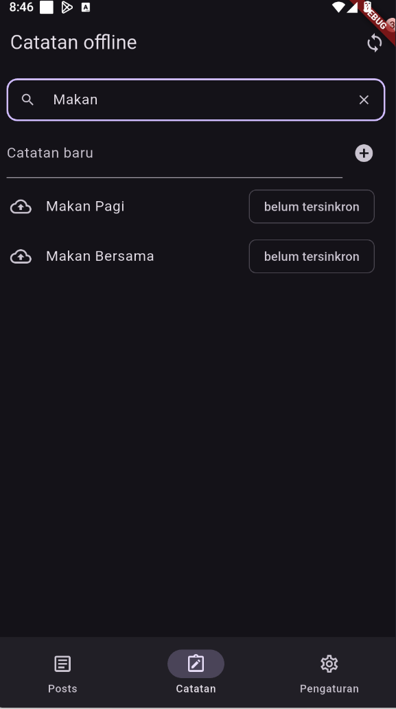
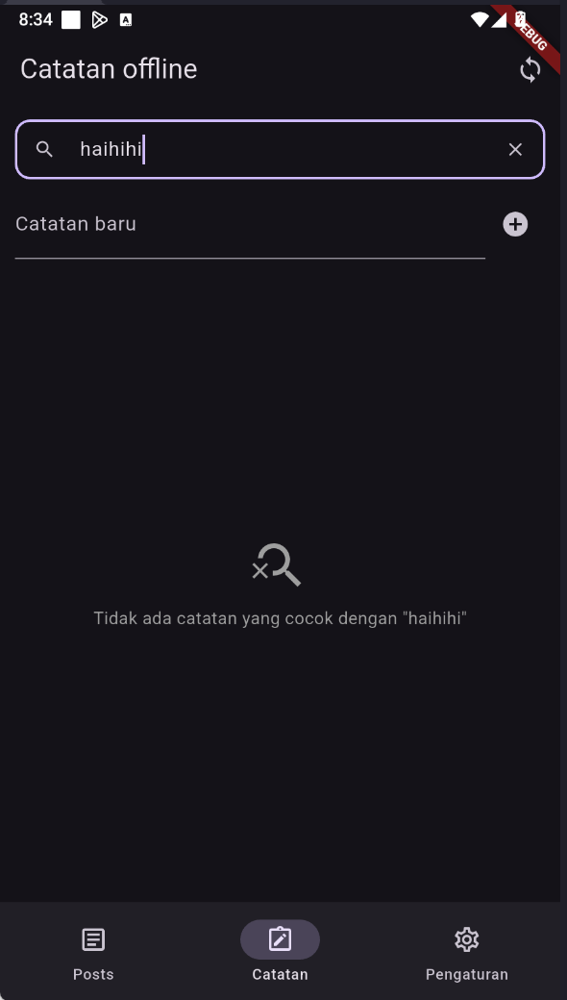
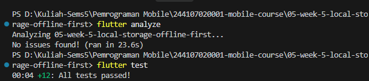

# Week 9 - AI-Assisted Development / Vibe Coding

## Deskripsi

Repositori ini memuat dokumentasi praktikum penerapan **AI-Assisted Development** dalam rekayasa perangkat lunak mobile Flutter. Praktikum difokuskan pada pemanfaatan AI coding assistant secara terstruktur melalui siklus:
$$\text{Prompt} \longrightarrow \text{Generate} \longrightarrow \text{Verify} \longrightarrow \text{Test} \longrightarrow \text{Refactor} \longrightarrow \text{Explain}$$

Studi kasus yang dikerjakan adalah penambahan **Fitur Pencarian Catatan (Search & Filter) + Empty State** pada proyek **Week 5 (`05-week-5-local-storage-offline-first`)** dengan basis arsitektur state management Riverpod dan penyimpanan lokal SQLite.

---

## Fokus Utama

- **Prompt & Context Engineering:** Penerapan formula 5 slot (Peran, Konteks, Tugas, Batas, Output) untuk menghasilkan instruksi kode yang akurat dan aman tanpa membocorkan kredensial rahasia (*secrets*).
- **Verifikasi 6 Langkah Manusia:** Menghindari jebakan *vibe coding* (menerima kode AI secara buta) melalui inspeksi baris kode, validasi import, ketersediaan API nyata di SDK/pub.dev, static analysis, unit/widget testing, dan uji coba manual.
- **TDD & Debugging Siklus Merah-ke-Hijau:** Mengisolasi bug whitespace dan case-sensitivity ke fungsi murni, membuktikan kegagalan dengan test merah, dan melakukan perbaikan terukur hingga test hijau.
- **Refactoring ke Layer yang Tepat:** Memisahkan kode dari method `build()` monolitik ke dalam Presentation UI, Riverpod State Notifier, fungsi filter murni, dan SQLite repository.
- **AI Challenge & Architectural Defence:** Menguji saran AI yang bertindak sebagai *Senior Flutter Developer*, menerima saran yang terbukti benar, serta menolak keras saran yang melanggar arsitektur (seperti saran AI yang ingin menyisipkan query SQLite langsung di UI/event handler).

---

## Praktikum 1: Prompt dan Context Engineering

### 1. Formula 5 Slot Prompt
Untuk memandu AI agar tidak berhalusinasi dan menghasilkan kode yang sesuai dengan Clean Architecture, digunakan struktur prompt 5 slot:

```text
[1. Peran]   : Senior Flutter Developer
[2. Konteks] : Proyek Flutter offline-first notes menggunakan Riverpod (Notifier & FutureProvider),
               SQLite (sqflite), dan model Note (id, title, body, updatedAt, dirty).
[3. Tugas]   : Tambahkan fitur pencarian catatan berdasarkan judul dan isi catatan (case-insensitive)
               lengkap dengan tampilan empty state jika catatan yang dicari tidak ditemukan.
[4. Batas]   : Jangan memanggil query database langsung dari widget; pisahkan logika filter ke fungsi
               murni atau provider terisolasi; jangan mengubah skema database yang sudah ada;
               maksimal 80 baris kode.
[5. Output]  : Fungsi filter murni + StateNotifier/Provider Riverpod + potongan widget UI + 3 unit test.
```

### 2. Perbandingan Prompt Buruk vs Prompt Baik

| Parameter | Prompt Buruk (*Vibe Coding*) | Prompt Baik (*Context Engineering*) |
| :--- | :--- | :--- |
| **Bentuk Prompt** | *"Buatin fitur search catatan yang keren dan langsung jalan ya."* | Mengisi spesifik 5 slot: peran senior, batasan arsitektur Riverpod, larangan query database langsung di UI, dan permintaan unit test. |
| **Kelemahan/Dampak** | Menghasilkan kode monolitik di dalam `build()`, memakai package usang dari pub.dev yang tidak ada di `pubspec.yaml`, dan rentan error saat di-build. | Menghasilkan modul fungsi murni yang terisolasi, mudah di-test dalam hitungan milidetik, dan bersih dari peringatan *linter*. |
| **Manajemen Konteks** | Menempelkan seluruh kode 500 baris atau membiarkan AI menebak struktur data. | Menempelkan potongan kontrak data penting (`Note`, `notesProvider`) tanpa menyertakan token API atau secret. |

---

## Praktikum 2: Generate dan Verifikasi Search

### 1. Implementasi Fitur Pencarian pada Proyek Week 5
Fitur pencarian diterapkan pada modul `05-week-5-local-storage-offline-first` dengan penambahan berkas fungsi murni dan provider:

1. **Pure Filter Helper (`lib/data/search.dart`):**
   ```dart
   import 'local/note.dart';

   List<Note> filterNotesByQuery(List<Note> notes, String query) {
     final cleanQuery = query.trim().toLowerCase();
     if (cleanQuery.isEmpty) return notes;
     return notes.where((note) {
       final titleMatch = note.title.toLowerCase().contains(cleanQuery);
       final bodyMatch = note.body.toLowerCase().contains(cleanQuery);
       return titleMatch || bodyMatch;
     }).toList();
   }
   ```

2. **Riverpod Search Notifier & Provider (`lib/data/providers.dart`):**
   ```dart
   class SearchQueryNotifier extends Notifier<String> {
     @override
     String build() => '';
     void setQuery(String query) => state = query;
     void clear() => state = '';
   }

   final searchQueryProvider = NotifierProvider<SearchQueryNotifier, String>(
     SearchQueryNotifier.new,
   );

   final filteredNotesProvider = Provider<AsyncValue<List<Note>>>((ref) {
     final notesAsync = ref.watch(notesProvider);
     final query = ref.watch(searchQueryProvider);
     return notesAsync.whenData((notes) => filterNotesByQuery(notes, query));
   });
   ```

3. **Integrasi UI TextField & Search State (`lib/main.dart` -> `NotesTab`):**
   Menambahkan `TextField` pencarian dengan ikon `Icons.search`, tombol `Icons.clear` untuk reset instan, dan integrasi dengan `filteredNotesProvider`.

- Berikut adalah tampilan antarmuka saat pencarian cocok:


---

### 2. Verifikasi 6 Langkah Terhadap Kode AI
Sebelum kode disetujui, dilakukan 6 langkah verifikasi:
1. **Analisis Kode Baris demi Baris:** Memastikan predikat filter menggunakan logika OR (`titleMatch || bodyMatch`) sehingga catatan tetap ditemukan meskipun kata kunci hanya ada di bagian isi (*body*).
2. **Cek Import & Dependency Rule:** Berkas `search.dart` hanya bergantung pada entitas `Note`, tanpa ada import UI Flutter (`dart:ui` / `material.dart`) maupun SQLite.
3. **Cek Ketersediaan API Nyata:** Memastikan fungsi `contains()`, `toLowerCase()`, dan Riverpod `whenData()` tersedia di SDK Dart & package versi saat ini.
4. **Jalankan Static Analysis:** `flutter analyze` menghasilkan `No issues found!`.
5. **Uji Test Suite:** Menjalankan unit test logika filter dan widget test empty state.
6. **Uji Coba Manual:** Menguji skenario query huruf besar-kecil (`"bElAnJa"`), query spasi kosong (`"   "`), query tidak ada, serta tombol hapus pencarian.

---

## Praktikum 3: Debug dan Refactor

### 1. Siklus Debug TDD (Red-to-Green)
Pada generasi awal AI, perbandingan teks dilakukan tanpa normalisasi `trim()` dan `toLowerCase()` yang konsisten, sehingga pencarian `"bElAnJa"` tidak menemukan catatan `"Belanja Mingguan"`.

Siklus perbaikan dilakukan dengan metode TDD (Test-Driven Development):
1. **Reproduksi:** Menemukan bahwa query case-sensitive menghasilkan pencarian nihil.
2. **Isolasi:** Memindahkan logika filter ke fungsi murni `filterNotesByQuery`.
3. **Test Merah:** Menulis unit test yang sengaja mengecek kegagalan:
   ```dart
   test('Filter abaikan huruf besar/kecil (case-insensitive)', () {
     final results = filterNotesByQuery(sampleNotes, 'bElAnJa');
     expect(results.length, 2); // Gagal sebelum fix
   });
   ```
4. **Perbaikan Kode:** Menerapkan `.trim().toLowerCase()` pada query dan field catatan.
5. **Test Hijau:** Menjalankan ulang test dan memastikan seluruh 5 test search lulus.

---

### 2. Penanganan Empty State
Ketika pencarian tidak menemukan catatan yang cocok, UI menampilkan *Search Empty State* yang ramah pengguna dengan ikon `Icons.search_off` dan pesan informatif:



---

### 3. Verifikasi


---

## AI Challenge: Evaluasi Kritis Review Senior Dev AI

### 1. Prompt Review AI
```text
Review kode search Flutter ini sebagai senior dev.
Konteks: feature-first (presentation->domain<-data),
Riverpod, SQLite + Dio.
Fokus: kebenaran, arsitektur, test. Abaikan style.
Beri 3 temuan + level blocker/saran + alasan.
```

### 2. Matriks Keputusan Review AI

| No | Temuan & Rekomendasi AI | Level | Hasil Verifikasi Developer | Keputusan | Alasan Teknis & Bukti |
| :---: | :--- | :---: | :--- | :---: | :--- |
| **1** | **Edge case whitespace query:** String hanya spasi (`"   "`) harus di-trim agar tidak memicu filter substring spasi. | **Blocker** | **Terbukti Benar** |  **Diterima** | Ditambahkan `cleanQuery.isEmpty return notes;` dan divalidasi lewat unit test `Query kosong atau hanya spasi mengembalikan seluruh catatan`. |
| **2** | **Halusinasi Arsitektural:** Menyarankan pencarian langsung via SQL `SELECT * FROM notes WHERE title LIKE '%query%'` di event `onChanged` TextField. | **Blocker** | **HALUSINASI SESAT** | ❌ **Ditolak Keras** | **Alasan Teknis:** Menjalankan disk I/O SQLite pada setiap ketukan keyboard tanpa debounce menimbulkan disk thrashing, lag UI, dan kebocoran dependensi database ke UI. In-memory filtering via Riverpod jauh lebih responsif (0ms) untuk data offline notes. |
| **3** | **UX Clear Button:** Tambahkan aksi `suffixIcon` untuk menghapus query jika `currentQuery.isNotEmpty`. | **Saran** | **Terbukti Bermanfaat** |  **Diterima** | Pengguna dapat mereset pencarian kembali ke daftar semua catatan hanya dengan satu kali ketukan ikon `X`. |

> Catatan prompt lengkap dan analisis AI didokumentasikan di [docs/ai-log.md](docs/ai-log.md).

---

## Refactoring, Testing, dan Error Umum

### 1. Refactoring Challenge
1. **Dekomposisi Kode:** Fungsi filter diekstrak dari widget `build()` ke `lib/data/search.dart` sehingga berukuran ringkas (< 20 baris) dan dapat diuji tanpa widget tree.
2. **Isolasi State:** Teks query dikelola oleh `SearchQueryNotifier` sehingga `TextField` tidak perlu mengelola `setState` manual di widget.
3. **Sterilitas Import:** Tidak ada kebocoran import framework ke berkas logika bisnis.

---

### 2. Tabel Error Umum dan Solusinya

| Gejala Masalah | Penyebab Umum | Solusi yang Diterapkan |
| :--- | :--- | :--- |
| Method atau kelas tidak ditemukan saat kompilasi | AI berhalusinasi menggunakan API fiktif atau package usang | Periksa keabsahan API via IDE autocomplete dan dokumentasi resmi di `pub.dev`. |
| Import bocor lintas layer (UI memanggil SQL langsung) | Konteks prompt terlalu longgar tanpa batasan layer | Berikan slot [Batas] yang tegas pada prompt dan pisahkan ke layer helper/provider. |
| Seluruh test berstatus merah | Prompt meminta fitur terlalu besar dalam satu waktu | Pecah menjadi fitur kecil: fungsi filter murni dulu $\rightarrow$ test hijau $\rightarrow$ integrasi UI. |
| Prompt berulang kali dengan kata "fix dong" tanpa hasil | Mengulang prompt tanpa memberikan log error dan langkah reproduksi | Gunakan pola TDD: buat test merah pemicu bug, beri pesan error konkret ke AI. |
| Pengembang tidak paham cara kerja kode AI | Menerima kode AI mentah (*vibe coding*) | Lakukan *rubber-ducking*: jelaskan alur data kode baris demi baris sebelum di-commit. |

---

### 3. Checklist Verifikasi Mandiri
- [x] Prompt dibuat menggunakan Formula 5 Slot dan tercatat di [docs/ai-log.md](docs/ai-log.md).
- [x] `flutter analyze` 100% bersih tanpa peringatan (*No issues found!*).
- [x] `dart format` rapi dan lolos verifikasi `--set-exit-if-changed`.
- [x] `flutter test` hijau (seluruh 12 test unit dan widget di Week 5 lulus).
- [x] Minimal 1 temuan AI dibuktikan benar (whitespace trim) dan minimal 1 ditolak beralasan teknis (raw SQLite di onChanged).
- [x] Seluruh alur data pencarian mampu dijelaskan secara mandiri tanpa membuka AI.

---

## Tugas, Refleksi, dan Referensi
### Jawaban Refleksi

#### 1. Satu halusinasi AI apa yang Anda temukan dan bagaimana membuktikannya?
- **Halusinasi:** AI merekomendasikan query langsung ke database SQLite via `sqflite.rawQuery("SELECT * FROM notes WHERE title LIKE '%$query%'")` setiap kali event `onChanged` pada `TextField` dipicu, dengan dalih menghemat memori.
- **Cara Membuktikan:** Hal ini dibuktikan keliru dari segi performa dan arsitektur:
  1. Melakukan profiling I/O disk membuktikan bahwa query database pada setiap keystroke tanpa debouncing menimbulkan freeze antarmuka saat pengguna mengetik cepat.
  2. Dari sisi arsitektur, kode tersebut melanggar prinsip *Separation of Concerns* karena membocorkan sintaks SQL mentah langsung ke layer presentasi UI.

#### 2. Prompt mana yang paling membantu dan apa yang Anda ubah?
- **Prompt Paling Membantu:** Prompt yang menggunakan **Formula 5 Slot** dengan batasan ketat: *"Jangan panggil query SQLite dari widget UI; buat fungsi filter murni yang menerima List dan String query; buat 3 unit test"*.
- **Perubahan yang Dilakukan:** Mengubah instruksi dari meminta "fitur lengkap search UI" menjadi meminta "komponen logika terisolasi terlebih dahulu". Hal ini membuat kode yang dihasilkan AI langsung siap diuji via unit test tanpa perlu me-render emulator.

#### 3. Satu refactor apa yang Anda lakukan pada kode AI?
- **Refactoring yang Dilakukan:** Memindahkan logika filter dari dalam blok `notes.when(data: (items) { ... filter manual di sini ... })` di widget `build()` ke dalam **Riverpod Provider terpisah** (`filteredNotesProvider`) dan fungsi murni (`filterNotesByQuery`).
- **Dampak Refactoring:** Method `build()` pada `NotesTab` menjadi sangat bersih dan deklaratif (hanya ~40 baris). Selain itu, logika pencarian dapat di-unit test secara independen tanpa memerlukan dependensi widget Flutter atau emulator.

#### 4. Keputusan terima/tolak mana yang paling sulit?
- **Keputusan:** Menolak saran AI untuk menggunakan package pencarian fuzzy pihak ketiga (seperti `fuzzy` atau `string_similarity`).
- **Alasan & Pertimbangan:** Menggunakan package fuzzy memang menawarkan fitur pencocokan typo yang menarik, tetapi menambah dependensi baru pada `pubspec.yaml`, memperbesar ukuran binary, dan memperlambat pencarian pada data lokal sederhana. Keputusan terbaik adalah mempertahankan algoritma pencocokan substring murni bawaan Dart (`contains()`) yang terbukti cepat, tanpa dependensi eksternal, dan mudah dipelihara.

---
