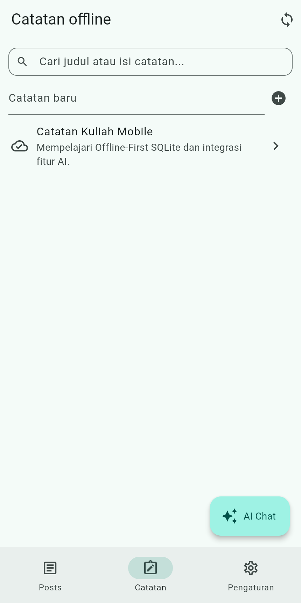
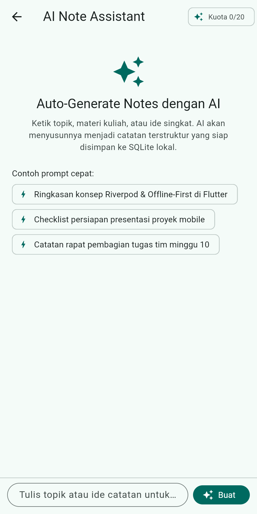
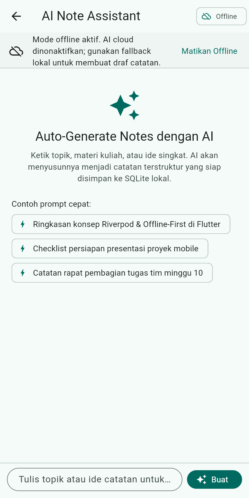
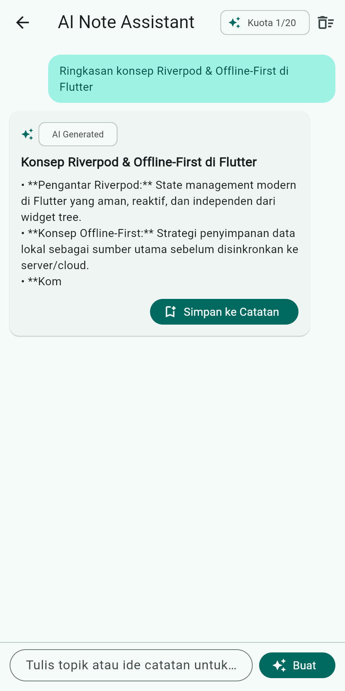
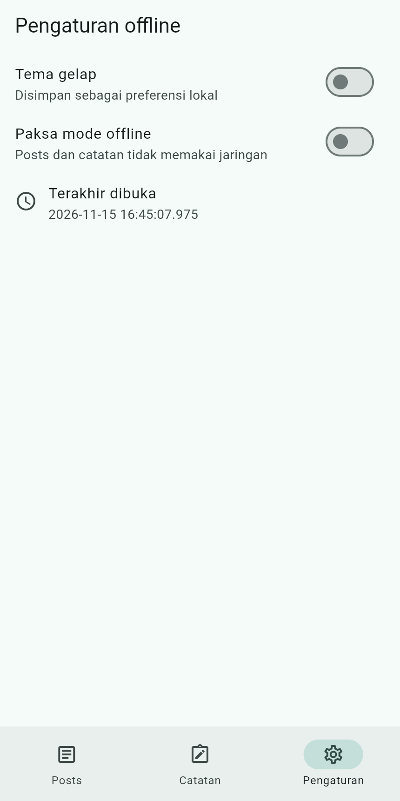
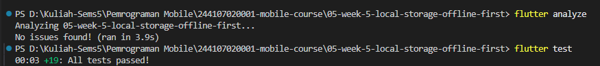

# Week 10 - AI Feature Integration

## Deskripsi

Repositori ini memuat hasil praktikum **Week 10 — Integrasi Fitur AI** dengan menambahkan fitur **AI Chat Auto-Generate Notes** pada proyek **Week 5 (`05-week-5-local-storage-offline-first`)** (*Offline First Notes* berbasis Flutter, Riverpod, dan SQLite).

Pengguna dapat menuliskan topik, ide singkat, atau memilih *quick prompt* di antarmuka chat (`AiChatScreen`), menerima draf catatan terstruktur (*judul + poin-poin isi*) dengan efek *streaming response*, lalu menyimpannya langsung ke penyimpanan lokal sebagai catatan baru (`dirty = true`) untuk disinkronkan saat online.

---

## Arsitektur & Komponen Utama

```text
+-----------------------+      HTTPS (REST)      +------------------------+
|  AiChatScreen (UI)    | <--------------------> |  Google AI Studio API  |
|  & SettingsTab        | gemini-flash-lite-latest|  (generateContent)     |
+-----------------------+                        +------------------------+
           |
           v  Riverpod (aiChatProvider / aiServiceProvider)
+-----------------------+
|      AiService        |  --> FlutterSecureStorage / .env (GEMINI_API_KEY)
|  - System Prompt      |  --> SharedPreferences (kuota harian 20 req)
|  - Privacy Guard      |  --> Local Cache (Map<String, Result>)
|  - Offline Fallback   |
+-----------------------+
           |
           v  Simpan ke Catatan
+-----------------------+
|    NoteRepository     |  --> SQLite (week5_offline.db) / Web memory
+-----------------------+
```

### Berkas yang Ditambahkan / Dimodifikasi

- **`05-week-5-local-storage-offline-first/lib/ai/ai_service.dart`** *(disalin juga ke `lib/ai/ai_service.dart`)*:
  - Manajemen API key terenkripsi dengan `flutter_secure_storage` serta fallback ke `.env` (`GEMINI_API_KEY` via `flutter_dotenv`, di-ignore dari git).
  - Pemanggilan Google AI Studio API (`gemini-flash-lite-latest`) menggunakan `http` dan `system_instruction`.
  - Proteksi privasi (`containsSensitiveData`) untuk memblokir input yang mengandung pola API key, NIK 16 digit, atau kata sandi.
  - *Rate limiting* harian (`maxDailyRequests = 20`) dan *in-memory cache* untuk prompt berulang.
  - *Streaming text chunk* dan *offline fallback generator* (`generateFallbackNote`).
- **`05-week-5-local-storage-offline-first/lib/features/chat_screen.dart`** *(disalin juga ke `lib/features/chat_screen.dart`)*:
  - Antarmuka chat Material 3 (`AiChatScreen`) dengan *quick prompt chips*, indikator *streaming*, kartu pratinjau catatan hasil AI + tombol **Simpan ke Catatan**, serta tombol **Gunakan Fallback Lokal** dan **Atur API Key** saat layanan AI tidak tersedia.
- **`05-week-5-local-storage-offline-first/lib/data/providers.dart`**:
  - Penambahan `aiServiceProvider`, `hasApiKeyProvider`, `aiDailyUsageProvider`, dan `aiChatProvider` (`AiChatNotifier`).
- **`05-week-5-local-storage-offline-first/lib/main.dart` & `lib/router.dart`**:
  - Penambahan `FloatingActionButton.extended` (**AI Chat**) di `NotesTab`, rute `/ai-chat`, serta pemuatan `.env` pada `main()`.
- **`10-week-10-ai-feature-integration/docs/ai-log.md`**:
  - Dokumentasi *system prompt*, *user prompt*, *raw output* awal AI, output *fallback* lokal, dan log proteksi privasi.

---

## Screenshot Hasil (Aplikasi Notes dari Week 5 dengan tambahan fitur AI Chat)

| 1. Tab Catatan + Tombol AI Chat | 2. Halaman Awal AI Note Assistant | 3. Mode Offline pada AI Chat |
| :---: | :---: | :---: |
|  |  |  |

| 4. Hasil Generate Catatan (`gemini-flash-lite-latest`) | 5. Halaman Pengaturan Offline |
| :---: | :---: |
|  |  |

---

## Dokumentasi Prompt & Log AI

Detail *system prompt*, *user prompt*, *output* awal AI, serta contoh keluaran *fallback* lokal tersedia pada berkas [`docs/ai-log.md`](docs/ai-log.md).

---

## Tabel Risiko dan Mitigasi (Privasi & Biaya)

| Risiko | Dampak | Mitigasi yang Diterapkan |
| :--- | :--- | :--- |
| **Kebocoran API Key di Source Code** | Penyalahgunaan kuota & tagihan tidak sah | API key tidak pernah di-*hardcode*; disimpan menggunakan `flutter_secure_storage` dan diinput pengguna lewat dialog `obscureText`. |
| **Bocor Data Pribadi / Sensitif Pengguna** | Data sensitif (NIK, password, token) terkirim ke server AI | `AiService.containsSensitiveData()` memvalidasi prompt secara lokal sebelum request keluar dan menolak prompt berpola sensitif (`AiPrivacyException`). |
| **Biaya API Melonjak / Spam Request** | Kuota habis cepat atau biaya membengkak | Pembatasan kuota harian (`maxDailyRequests = 20` per hari via `SharedPreferences`) dan *local cache* untuk prompt yang sama. |
| **AI API Error / Offline / Rate Limit** | Pengguna gagal membuat catatan dan aplikasi terasa macet | Penanganan exception terstruktur (`AiMissingKeyException`, `AiOfflineException`, `AiQuotaExceededException`, `AiApiException`) disertai opsi **Gunakan Fallback Lokal** yang membuat draf catatan secara offline. |
| **Respons AI Tidak Sesuai Format** | Aplikasi gagal memisahkan judul dan isi catatan | *System prompt* mengunci format `JUDUL:` / `ISI:`, dan `parseGeneratedNote()` menyediakan *fallback parser* baris-pertama jika format menyimpang. |

---

## Bukti Mesin Hijau (`flutter analyze` & `flutter test`)



---

## Refleksi

1. **Fitur AI mana yang Anda integrasikan dan mengapa?**
   Fitur **Chat Auto-Generate Notes** karena paling relevan dengan aplikasi *Offline First Notes* dari Week 5: pengguna sering memiliki ide atau topik belajar singkat yang ingin langsung diubah menjadi catatan terstruktur tanpa harus mengetik manual dari nol.
2. **Bagaimana Anda melindungi privasi pengguna saat menggunakan AI API?**
   API key disimpan terenkripsi menggunakan `flutter_secure_storage`, prompt tidak menyertakan isi database catatan pengguna lain secara otomatis, dan input diperiksa terlebih dahulu oleh `containsSensitiveData()` untuk memblokir pola API key, password, atau NIK 16 digit sebelum dikirim ke cloud.
3. **Fallback apa yang Anda sediakan jika layanan AI error?**
   Jika API key belum diatur, perangkat berada dalam mode `forceOffline`, kuota harian habis, atau server AI gagal merespons, antarmuka menampilkan kartu status yang ramah lengkap dengan tombol **Gunakan Fallback Lokal** untuk menyusun draf catatan terstruktur secara lokal dan **Atur API Key**.
4. **Satu hal yang Anda pelajari tentang UX fitur AI di mobile?**
   Pengguna membutuhkan umpan balik progres yang jelas (indikator *streaming* bertahap) dan kontrol penuh sebelum data AI masuk ke penyimpanan utama—menyediakan kartu pratinjau dengan tombol **Simpan ke Catatan** membuat pengguna dapat meninjau hasil AI terlebih dahulu sebelum menyimpannya ke SQLite.
