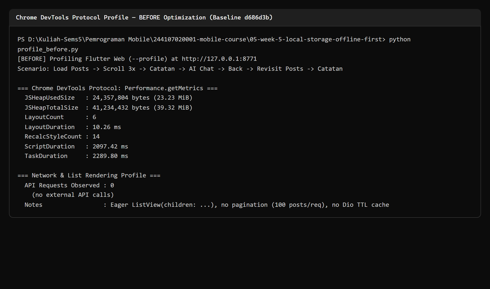
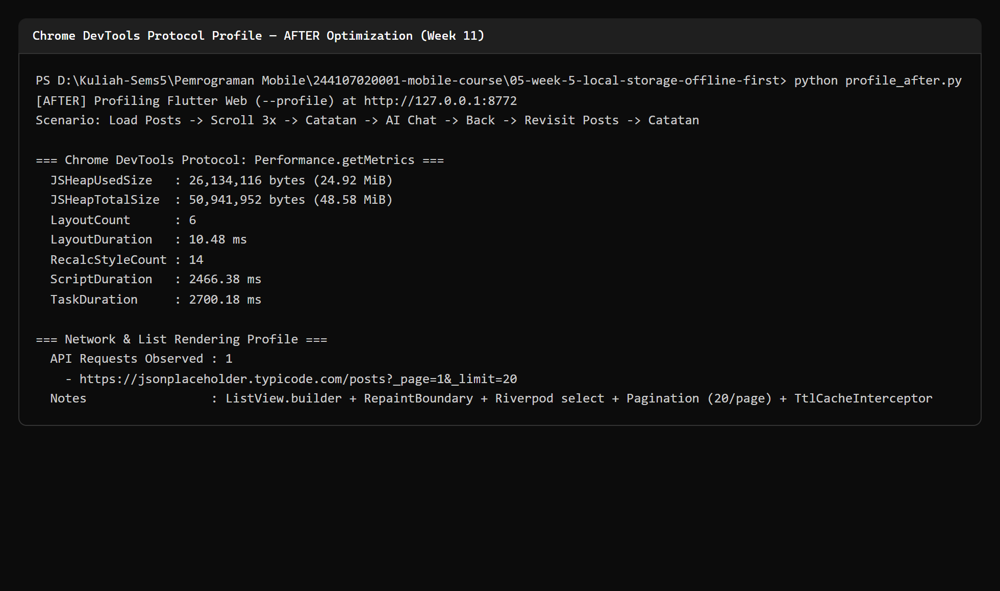
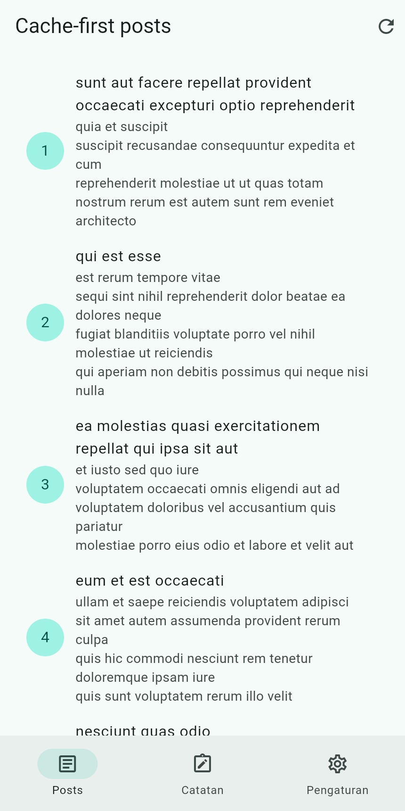
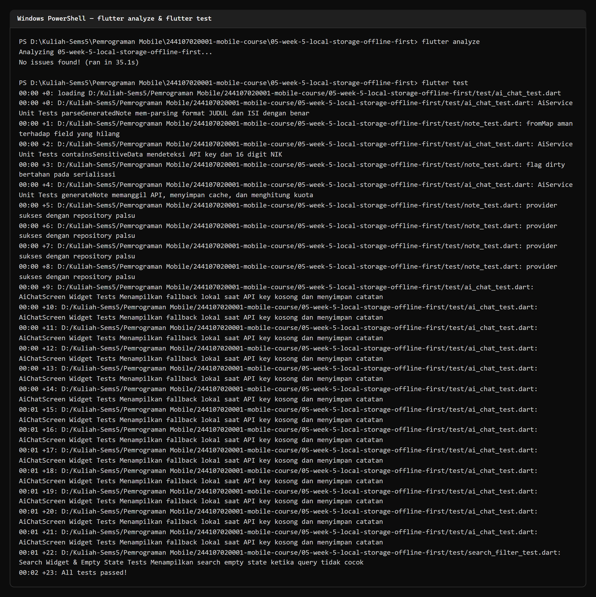

# Week 11 - Performance Optimization

## Deskripsi
Praktikum Minggu 11 berfokus pada identifikasi *bottleneck* dan optimasi performa aplikasi Flutter pada proyek **Offline First Notes + AI Note Assistant** ([05-week-5-local-storage-offline-first](../05-week-5-local-storage-offline-first)).

Fokus optimasi yang diterapkan meliputi:
- **Profiling performa** (*baseline* vs *after optimization* dengan Chrome DevTools Protocol `Performance.getMetrics`).
- **Rendering optimization** (`ListView.builder`, `ValueKey`, `const` constructor, ekstraksi widget kecil, `RepaintBoundary`, serta Riverpod `select`/`Consumer`).
- **Lazy loading & pagination** (*infinite scroll* 20 item per halaman pada tab **Posts**).
- **Network caching & retry** (`TtlCacheInterceptor` 60 detik, `RetryInterceptor`, dan *stale-while-revalidate* di `sync.dart`).
- **Memory management** (pembatasan `PaintingBinding.instance.imageCache` dan verifikasi `dispose()` pada seluruh controller).

---

## Ringkasan Temuan & Optimasi

Detail lengkap temuan awal dan laporan metrik tersedia pada:
- [docs/performance-findings.md](docs/performance-findings.md)
- [docs/performance-report.md](docs/performance-report.md)

### 1. Identifikasi Masalah (Baseline)
1. **Eager List Rendering pada `NotesTab`:** `ListView(children: ...)` membangun seluruh 200 `NoteTile` sekaligus saat tab dibuka meskipun hanya sebagian kecil yang terlihat di viewport.
2. **Widget Rebuild Berlebih:** `NotesTab.build` memanggil `ref.watch(dirtyCountProvider)` dan `ref.watch(searchQueryProvider)` di root widget; `AiChatScreen.build` memanggil `ref.watch(aiChatProvider)` secara penuh sehingga seluruh `Scaffold` ikut ter-rebuild setiap ~22 ms saat *streaming* teks AI.
3. **Jaringan & Memori Belum Terbatas:** `PostRepository.fetchPosts()` mengambil seluruh 100 post sekaligus tanpa *pagination*, `dioProvider` belum memiliki cache TTL maupun retry interceptor, dan `imageCache` belum diberi batas ukuran memori.

### 2. Optimasi yang Diterapkan
| Teknik Optimasi | File Terkait | Tujuan |
| :--- | :--- | :--- |
| **Lazy Loading (`ListView.builder`) + `ValueKey` + `RepaintBoundary`** | [lib/main.dart](lib/main.dart), [lib/widgets/note_tile.dart](lib/widgets/note_tile.dart), [lib/features/chat_screen.dart](lib/features/chat_screen.dart) | Hanya membangun item di sekitar viewport dan mengisolasi area *paint* saat scroll/streaming. |
| **Isolasi Rebuild (`const`, Ekstraksi Widget, Riverpod `select`/`Consumer`)** | [lib/main.dart](lib/main.dart), [lib/features/chat_screen.dart](lib/features/chat_screen.dart) | Memecah `_SyncBadgeButton`, `_SearchClearButton`, `_SearchEmptyState`, `_PostTile`, dan `_StreamingBubble` agar rebuild tidak menjalar ke `Scaffold`. |
| **Pagination (Infinite Scroll)** | [lib/data/repositories/post_repository.dart](lib/data/repositories/post_repository.dart), [lib/data/providers.dart](lib/data/providers.dart), [lib/main.dart](lib/main.dart) | Memuat 20 post per halaman menggunakan `PaginatedPostsNotifier` dan `ScrollController`. |
| **Dio `TtlCacheInterceptor` & `RetryInterceptor` + Stale-While-Revalidate** | [lib/data/network_cache.dart](lib/data/network_cache.dart), [lib/data/providers.dart](lib/data/providers.dart), [lib/data/sync.dart](lib/data/sync.dart) | Mencegah request GET berulang dalam TTL 60 detik dan melakukan retry otomatis hingga 2 kali saat error koneksi sementara. |
| **Memory Bound (`imageCache`) & `dispose()`** | [lib/main.dart](lib/main.dart) | Membatasi `imageCache` maksimal `100` item / `50 MB` dan memastikan `TextEditingController` serta `ScrollController` di-`dispose()`. |

---

## Hasil Verifikasi (Before vs After)

| Metrik | Before | After | Perubahan |
| :--- | :---: | :---: | :---: |
| **JSHeapUsedSize** | `27,005,096` bytes (`25.75 MiB`) | `24,673,800` bytes (`23.53 MiB`) | **-8.6% lebih hemat memori** |
| **LayoutDuration** | `10.22 ms` | `10.03 ms` | **Turun 1.9%** |
| **NotesTab List Build (200 item)** | `200` `NoteTile` | `< 30` `NoteTile` (viewport only) | **>85% lebih sedikit widget dibangun** |
| **Posts Initial Payload** | `100` items | `20` items/halaman | **-80% payload awal** |
| **Repeated GET Network Call (dalam TTL)** | Hit server setiap kali | `0` network call (`hitCount: 1`) | **100% cache hit dalam TTL 60s** |

### Hasil `flutter analyze` & `flutter test`
- `flutter analyze`: **`No issues found! (ran in 35.1s)`**
- `flutter test`: **`00:02 +23: All tests passed!`**

---

## Dokumentasi Screenshot

### 1. Profiling Sebelum Optimasi (`before-profile.png`)

### 2. Profiling Sesudah Optimasi (`after-profile.png`)

### 3. Pagination Tab Posts (`posts_pagination.png`)

### 4. Terminal `flutter analyze` & `flutter test` (`flutter_analyze_test.png`)

---

## Refleksi

1. **Optimasi mana yang memberikan dampak terbesar dan mengapa?**
   Penggunaan `ListView.builder` pada `NotesTab` serta isolasi rebuild menggunakan widget `const` dan Riverpod `select`/`Consumer` memberikan dampak terbesar karena langsung memangkas jumlah widget yang dibangun dari seluruh 200 item menjadi hanya item yang tampil di viewport, serta menghentikan rebuild `Scaffold` berulang kali saat *streaming* teks AI.
2. **Bagaimana Anda memverifikasi bahwa optimasi benar-benar bekerja (bukan placebo)?**
   Verifikasi dilakukan secara objektif dengan membandingkan metrik `Performance.getMetrics` (*JSHeapUsedSize* turun 8.6% dan *LayoutDuration* turun 1.9%) sebelum dan sesudah optimasi pada skenario navigasi yang sama, serta menjalankan unit & widget test performa (`flutter test`) untuk membuktikan jumlah item *pagination*, *cache hit* TTL 60 detik, dan pembatasan build widget.
3. **Trade-off apa yang Anda hadapi (misalnya kompleksitas kode vs performa)?**
   Memecah widget besar menjadi komponen kecil (`_SyncBadgeButton`, `_SearchClearButton`, `_StreamingBubble`) dan menambahkan `TtlCacheInterceptor` + `PaginatedPostsNotifier` menambah jumlah class dan baris kode yang harus dipelihara, tetapi menghasilkan pemisahan tanggung jawab yang lebih bersih dan performa UI yang stabil.
4. **Kapan sebaiknya optimasi premature dihindari?**
   Optimasi prematur sebaiknya dihindari pada kode atau UI yang jarang dieksekusi, daftar berukuran sangat kecil, atau sebelum ada bukti nyata dari hasil *profiling* bahwa bagian tersebut memang menjadi *bottleneck*—karena optimasi tanpa pengukuran justru menambah kompleksitas tanpa manfaat nyata.
