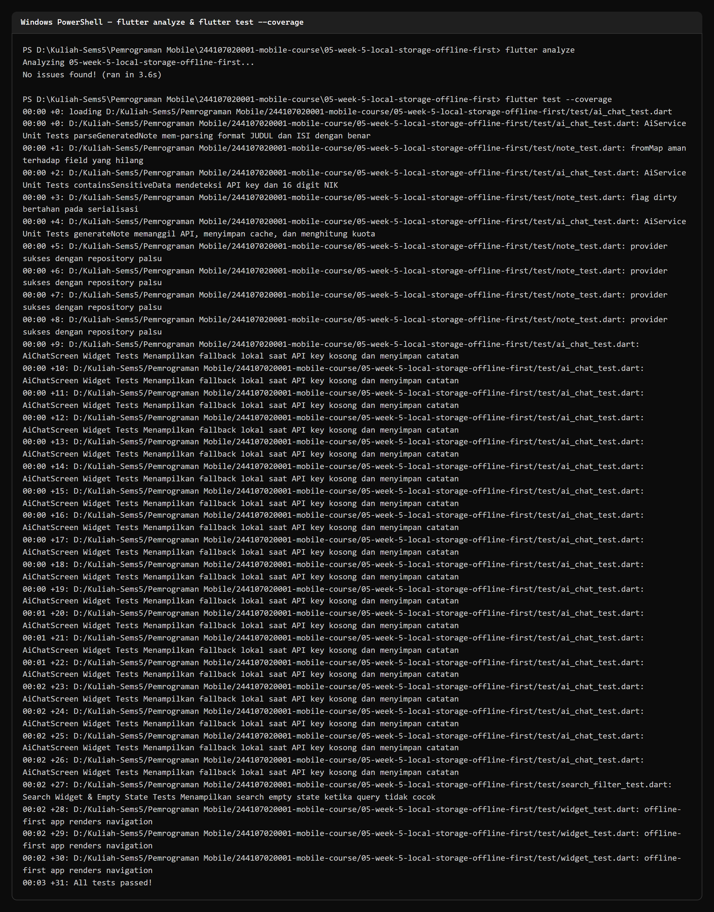
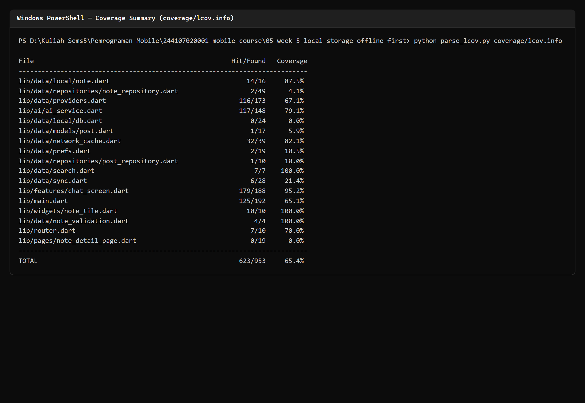
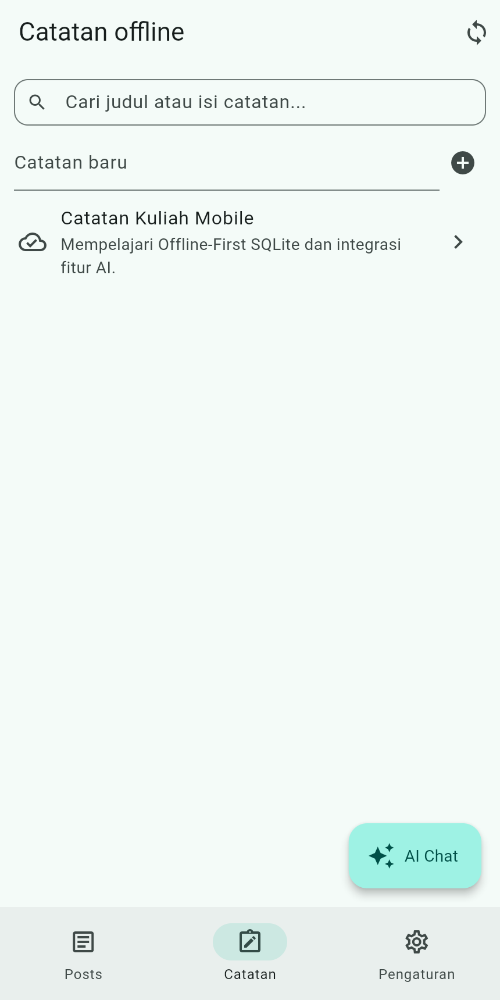

# Week 12 - Pengujian dan Jaminan Kualitas (Testing & Quality Assurance)

## Deskripsi
Praktikum Minggu 12 menerapkan strategi pengujian berlapis (*unit test*, *widget test*, dan *integration test*) serta analisis kualitas kode pada proyek Flutter **Offline-First Notes + AI Note Assistant** ([05-week-5-local-storage-offline-first](../05-week-5-local-storage-offline-first)).

Fokus utama pada minggu ini adalah:
1. Memisahkan logika validasi ke dalam fungsi murni ([lib/data/note_validation.dart](../05-week-5-local-storage-offline-first/lib/data/note_validation.dart)) agar mudah diuji secara unit.
2. Menyusun *test suite* ([test/qa_suite_test.dart](../05-week-5-local-storage-offline-first/test/qa_suite_test.dart)) yang mencakup kasus sukses, kasus tepi (*edge case*), dan kondisi kegagalan (*error state*) menggunakan *fake repository*.
3. Menambahkan pengujian integrasi end-to-end ([integration_test/app_test.dart](../05-week-5-local-storage-offline-first/integration_test/app_test.dart)).
4. Mengevaluasi hasil `flutter analyze`, `flutter test --coverage`, dan laporan cakupan `coverage/lcov.info`.

---

## Strategi & Skenario Pengujian

| Lapisan Pengujian | Target | Cakupan Skenario |
| :--- | :--- | :--- |
| **Unit Test** | `isValidNoteTitle`, `normalizeNoteTitle` | Menolak string kosong, menolak string hanya spasi (*edge case*), menolak judul > 120 karakter (*edge case*), menerima judul valid dengan trim spasi. |
| **Unit Test (Fake Repository)** | Abstraksi `NotesRepo` via `_FakeNotesRepo` | Mengambil daftar catatan dalam kondisi normal (sukses) dan melempar `StateError` saat simulasi kegagalan database/repository (error). |
| **Widget Test** | `NotesTab` | Menampilkan snackbar `'Judul catatan tidak boleh kosong atau > 120 karakter.'` saat input kosong, berhasil menambah catatan valid ke UI, dan merender state error saat stream catatan gagal. |
| **Integration Test** | Alur utama `MyApp` | Membuka tab **Catatan**, menambahkan catatan `'Tugas QA Minggu 12'`, menekan FAB AI (`Key('open_ai_chat_fab')`), dan memverifikasi halaman **AI Note Assistant** terbuka. |

### Implementasi Kunci
- **Validasi Judul Catatan:** [lib/data/note_validation.dart](../05-week-5-local-storage-offline-first/lib/data/note_validation.dart) (`isValidNoteTitle`, `normalizeNoteTitle`).
- **Integrasi UI & Key Pengujian:** [lib/main.dart](../05-week-5-local-storage-offline-first/lib/main.dart) (`NotesTab._addNote`, `Key('add_note_field')`, `Key('add_note_button')`).
- **Suite Pengujian QA (8 test case dalam 3 `group`):** [test/qa_suite_test.dart](../05-week-5-local-storage-offline-first/test/qa_suite_test.dart) (salinan dokumentasi tersedia di [test/qa_suite_test.dart](test/qa_suite_test.dart)).
- **Integration Test:** [integration_test/app_test.dart](../05-week-5-local-storage-offline-first/integration_test/app_test.dart) (salinan dokumentasi tersedia di [test/integration_test/app_test.dart](test/integration_test/app_test.dart)).

---

## Hasil Pemeriksaan (`flutter analyze` & `flutter test --coverage`)

Semua pengujian dan analisis statis dijalankan pada direktori `05-week-5-local-storage-offline-first`:

1. **Analisis Statis (`flutter analyze`)**
   ```bash
   flutter analyze
   ```
   **Hasil:** `No issues found! (ran in 3.6s)`

2. **Unit & Widget Test + Coverage (`flutter test --coverage`)**
   ```bash
   flutter test --coverage
   ```
   **Hasil:** `00:03 +31: All tests passed!` (total 31 test cases lulus dari seluruh test suite termasuk `qa_suite_test.dart`).

3. **Integration Test (`flutter test integration_test/app_test.dart`)**
   ```bash
   flutter test integration_test/app_test.dart -d <device_id>
   ```
   **Kendala Perangkat/Environment:**
   - Pada environment Windows ini tidak tersedia emulator Android (`flutter emulators` tidak memiliki emulator terkonfigurasi).
   - Target `Windows (desktop)` memerlukan *Developer Mode* aktif untuk pembuatan symlink plugin Flutter.
   - Target `Chrome` untuk `integration_test` memerlukan `chromedriver` berjalan terpisah pada port `4444`.
   - Oleh karena itu, skrip `integration_test/app_test.dart` telah diverifikasi bebas error oleh `flutter analyze` dan siap dijalankan ketika emulator Android atau `chromedriver` tersedia.

---

## Ringkasan Cakupan Kode (`coverage/lcov.info`)

Salinan laporan cakupan tersimpan di [coverage/lcov.info](coverage/lcov.info). Total cakupan dari seluruh file yang tercatat adalah **623 / 953 baris (65.4%)**.

| File | Baris Tercakup | Persentase |
| :--- | :---: | :---: |
| `lib/data/note_validation.dart` | 4 / 4 | 100.0% |
| `lib/data/search.dart` | 7 / 7 | 100.0% |
| `lib/widgets/note_tile.dart` | 10 / 10 | 100.0% |
| `lib/features/chat_screen.dart` | 179 / 188 | 95.2% |
| `lib/data/local/note.dart` | 14 / 16 | 87.5% |
| `lib/data/network_cache.dart` | 32 / 39 | 82.1% |
| `lib/ai/ai_service.dart` | 117 / 148 | 79.1% |
| `lib/router.dart` | 7 / 10 | 70.0% |
| `lib/data/providers.dart` | 116 / 173 | 67.1% |
| `lib/main.dart` | 125 / 192 | 65.1% |
| `lib/data/sync.dart` | 6 / 28 | 21.4% |
| `lib/data/prefs.dart` | 2 / 19 | 10.5% |
| `lib/data/repositories/post_repository.dart` | 1 / 10 | 10.0% |
| `lib/data/models/post.dart` | 1 / 17 | 5.9% |
| `lib/data/repositories/note_repository.dart` | 2 / 49 | 4.1% |
| `lib/data/local/db.dart` | 0 / 24 | 0.0% |
| `lib/pages/note_detail_page.dart` | 0 / 19 | 0.0% |
| **TOTAL** | **623 / 953** | **65.4%** |

### Temuan Area Belum Tercakup / Belum Terselesaikan
- `lib/data/local/db.dart` (0.0%) dan `lib/data/repositories/note_repository.dart` (4.1%) belum diuji terhadap SQLite/Drift nyata karena pengujian unit/widget memakai *fake repository* agar deterministik dan cepat.
- `lib/pages/note_detail_page.dart` (0.0%) belum memiliki *widget test* khusus untuk halaman detail catatan.
- `integration_test/app_test.dart` belum dieksekusi di emulator Android/desktop karena keterbatasan perangkat pada environment saat ini.

---

## Dokumentasi Screenshot

### 1. Hasil Terminal `flutter analyze` & `flutter test --coverage`


### 2. Ringkasan Cakupan Kode (`coverage/lcov.info`)


### 3. Aplikasi Berjalan


---

## Refleksi

1. **Bug apa yang paling mungkin terlewat tanpa pengujian yang Anda tulis?**
   Input berupa spasi kosong (`"   "`) atau judul yang sangat panjang (> 120 karakter) berisiko lolos ke database lokal bila validasi hanya mengandalkan pengecekan sederhana di UI, serta kegagalan stream repository yang tidak tertangani bisa membuat layar catatan tampak kosong tanpa pesan error.
2. **Bagian mana yang perlu fake, dan bagaimana fake itu membuat pengujian lebih konsisten?**
   Lapisan akses data (`NotesRepo` / database Drift / layanan AI) perlu diganti dengan *fake* (`_FakeNotesRepo` dan fake AI service) karena operasi I/O disk dan jaringan bersifat lambat, bergantung pada state eksternal, dan sulit dipaksa gagal secara terkendali. Dengan *fake*, skenario sukses maupun error dapat diuji berulang kali secara instan dan deterministik.
3. **Apa perbedaan nilai yang diberikan pengujian widget dan pengujian integrasi pada fitur Anda?**
   Pengujian widget (`NotesTab`) memverifikasi perilaku komponen UI secara terisolasi dan cepat (tampilan awal, pesan validasi SnackBar, dan tampilan error stream), sedangkan pengujian integrasi (`app_test.dart`) memverifikasi keterhubungan antar-fitur dari awal hingga akhir (menambah catatan di tab Catatan lalu berpindah ke AI Note Assistant melalui FAB).
